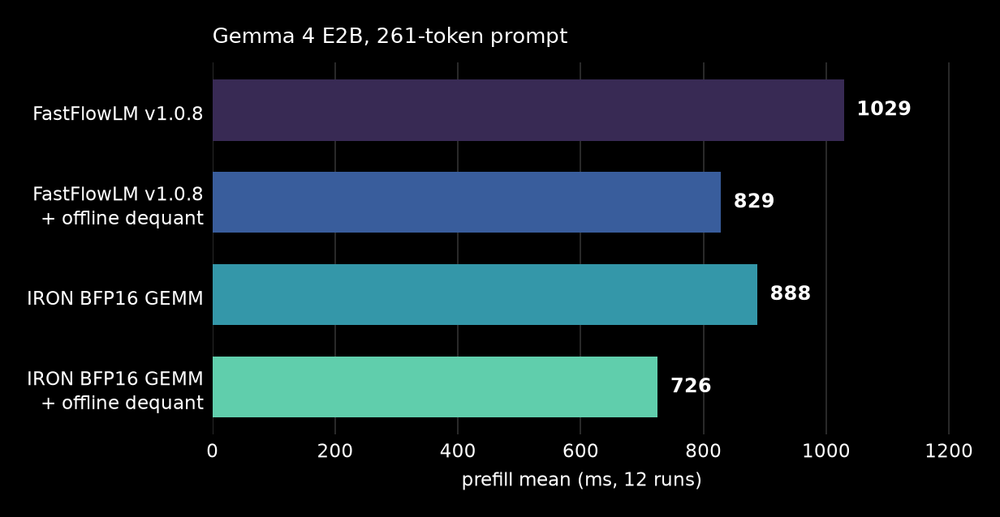

<!--
SPDX-FileCopyrightText: Copyright (C) 2026 Advanced Micro Devices, Inc. All rights reserved.
SPDX-License-Identifier: Apache-2.0
-->

# Explore Gemma 4 GEMM and dequant overrides

This example uses FastFlowLM's compile-time operator overrides to explore two
choices in the Gemma 4 E2B prefill path:

- FastFlowLM GEMM or IRON BFP16 GEMM;
- runtime dequantization or weights dequantized before inference.

Offline dequantization removes work from each prefill. It also increases model
storage, device memory, and startup time because the engine loads resident
weights. BF16 weights use about 3.45 GiB. Packed BFP16 weights use about
1.94 GiB. Runtime dequantization retains the 4-bit weights and uses reusable
staging buffers. Operator overrides let us measure this trade space inside the
same model schedule while FastFlowLM runs every other operator.

The graph below reports the mean prefill time from 12 measured requests after
one warm-up request per selection. All selections generated identical token
IDs. These measurements used FastFlowLM v1.0.8, an NPU2 device, and the
261-token prompt in the test.



You need an NPU2 device, an IRON environment, the
[FastFlowLM build dependencies],
and Gemma 4 E2B weights. The commands below run from this directory.

[FastFlowLM build dependencies]: https://github.com/ROCm/FastFlowLM/blob/main/docs/linux-getting-started.md#building-from-source

## Build the FastFlowLM inference engine

We will be using the following paths throughout:

```bash
export IRON=$(git rev-parse --show-toplevel)
export APP=$IRON/iron/applications/gemma4_flm
export BUILD=$APP/build
export OUTPUT=$BUILD/gemm_dequant
export FLM=$BUILD/FastFlowLM/src
export FLM_MODEL_PATH=/path/to/fastflowlm-models-dir
```

`FLM_MODEL_PATH` must point to the parent of the `models` directory that
contains the Gemma 4 weights. FastFlowLM appends `/models` to the path. The
steps below explain how to download the weights if you do not have them.

Pull and build the unmodified ("stock") FastFlowLM engine for comparison:

```bash
git clone https://github.com/ROCm/FastFlowLM $BUILD/FastFlowLM
git -C $BUILD/FastFlowLM checkout v1.0.8
git -C $BUILD/FastFlowLM submodule update --init --recursive

cmake -S $FLM -B $BUILD/stock -G Ninja \
    -DFLM_VERSION=1.0.8 -DNPU_VERSION=32.0.203.304 \
    -DFLM_BUILD_GEMMA4E=ON
cmake --build $BUILD/stock --parallel 2
```

If the weights are absent from `$FLM_MODEL_PATH/models`, download them with the
engine you just built:

```bash
cd $FLM
FLM_MODELINFO_PATH=$FLM/model_info.json \
    $BUILD/stock/flm pull gemma4-it:e2b
```

## Build the replacement IRON operators

Now build the NPU programs for the operators you want to replace.
`build_gemm_dequant.py` compiles the Gemma 4 E2B shapes and creates a copy of
FastFlowLM's xclbin directory under `$OUTPUT/xclbins`. It replaces only
`mm.xclbin` and `dequant.xclbin`. The instruction streams go in the adjacent
`iron/` directory.

```bash
cd $APP
python3 build_gemm_dequant.py $FLM/xclbins $OUTPUT
```

The script builds the GEMM row counts needed by `--prefill-chunk-len 512`.
Increase `CHUNK` in `build_gemm_dequant.py` to serve larger chunks.

## Build offline weights

The offline selections use sidecar files next to `model.q4nx`. The converter
reproduces FastFlowLM's BF16 floor rounding. For IRON GEMM, it then calls
IRON's BFP16 packer.

```bash
MODEL=$FLM_MODEL_PATH/models/Gemma4-E2B-IT-NPU2

python3 dequantize.py $MODEL --mode bf16
IRON_PATH=$IRON python3 dequantize.py $MODEL \
    --mode bfp --only "mlp."
IRON_PATH=$IRON python3 dequantize.py $MODEL \
    --mode bfp --only "self_attn." --out model.dq_bfp_attn
```

This creates:

- `model.dq_bf16` for FastFlowLM GEMM with offline dequantization;
- `model.dq_bfp` and `model.dq_bfp_attn` for IRON GEMM with offline
    dequantization.

## The override header

Next, build a modified FastFlowLM engine that runs the IRON operators instead
of the built-in stock operators.
[`gemm_dequant_overrides.hpp`](gemm_dequant_overrides.hpp) is the source header
that defines these replacements.

In the FastFlowLM source code, dispatches use `FLM_OVERRIDE` like this:

```cpp
FLM_OVERRIDE(q_swa_proj, q_swa_proj(out, in, weights), desc, type, shape)
```

This makes each dispatch overridable. Without an override header,
`FLM_OVERRIDE` evaluates the second argument. This example's header redefines
the macro so that the operator name selects another macro:

```cpp
#define FLM_OVERRIDE(name, expr, ...) \
    FLM_OV_##name(expr __VA_OPT__(, ) __VA_ARGS__)

#define FLM_OV_q_swa_proj(expr, desc, type, shape) \
    ::iron::q_proj((desc)->weight_desc(type), shape, bufs, qkv_weights)
```

The replacement macro runs the IRON operator on the buffers at that call site.
The header marks the hooks it replaces. Its generic fallback evaluates `expr`
for every unmarked hook, so unused hooks need no definitions. This header marks
only projection GEMM, dequant, and the setup hooks they require.

With runtime dequantization, GEMM and dequant form one replacement set. IRON
dequant writes the BFP16 layout that IRON GEMM reads. The offline modes load
the same consumer-specific layouts once and replace the dequant hooks with
completed no-ops.

To experiment with another operator, add its `FLM_OV_<name>` macro and preserve
the exact result type and buffer lifetime of the expression it replaces.

## Build the override engines

Build three variants of the override engine. The nested quotes make
`FLM_OVERRIDES` a C++ include string. The stock build from the first section is
the fourth selection.

```bash
OVERRIDE_FLAGS="-I$APP -DFLM_OVERRIDES=\"\\\"gemm_dequant_overrides.hpp\\\"\""

# IRON GEMM with runtime IRON dequant.
cmake -S $FLM -B $OUTPUT/engine -G Ninja \
    -DFLM_VERSION=1.0.8 -DNPU_VERSION=32.0.203.304 \
    -DFLM_BUILD_GEMMA4E=ON \
    "-DFLM_OVERRIDE_FLAGS=$OVERRIDE_FLAGS"
cmake --build $OUTPUT/engine --target gemma4e_npu --parallel 2

# FastFlowLM GEMM with resident BF16 weights.
cmake -S $FLM -B $OUTPUT/engine_bf16 -G Ninja \
    -DFLM_VERSION=1.0.8 -DNPU_VERSION=32.0.203.304 \
    -DFLM_BUILD_GEMMA4E=ON \
    "-DFLM_OVERRIDE_FLAGS=$OVERRIDE_FLAGS -DIRON_OFFLINE_BF16"
cmake --build $OUTPUT/engine_bf16 --target gemma4e_npu --parallel 2

# IRON GEMM with resident BFP16 weights.
cmake -S $FLM -B $OUTPUT/engine_bfp16 -G Ninja \
    -DFLM_VERSION=1.0.8 -DNPU_VERSION=32.0.203.304 \
    -DFLM_BUILD_GEMMA4E=ON \
    "-DFLM_OVERRIDE_FLAGS=$OVERRIDE_FLAGS -DIRON_OFFLINE_BFP16"
cmake --build $OUTPUT/engine_bfp16 --target gemma4e_npu --parallel 2
```

Edit the header and rebuild the relevant variant to test another
implementation.

## Run a selection

Run the stock FastFlowLM engine:

```bash
cd $FLM
LD_LIBRARY_PATH=$BUILD/stock/engines FLM_XCLBIN_PATH=$FLM \
    $BUILD/stock/flm serve gemma4-it:e2b \
    --prefill-chunk-len 512 --port 11434
```

Run IRON GEMM with runtime IRON dequant on another port:

```bash
cd $FLM
LD_LIBRARY_PATH=$OUTPUT/engine/engines FLM_XCLBIN_PATH=$OUTPUT \
    $BUILD/stock/flm serve gemma4-it:e2b \
    --prefill-chunk-len 512 --port 11435
```

Send the same request to each port:

```bash
# Test stock:
REQUEST='{
  "model": "gemma4-it:e2b",
  "prompt": "Explain block floating point in two sentences.",
  "stream": false,
  "max_tokens": 64
}'
curl -s http://127.0.0.1:11434/api/generate -d \
    "$REQUEST"

# Test IRON-overridden:
curl -s http://127.0.0.1:11435/api/generate -d \
    "$REQUEST"
```

Compare `context` for token IDs and `prompt_eval_duration` for prefill time.
The duration is in nanoseconds.

The offline BF16 engine must use FastFlowLM's stock xclbins:

```bash
LD_LIBRARY_PATH=$OUTPUT/engine_bf16/engines \
    FLM_XCLBIN_PATH=$FLM \
    $BUILD/stock/flm serve gemma4-it:e2b \
    --prefill-chunk-len 512 --port 11436
```

The offline BFP16 engine uses the staged IRON xclbins:

```bash
LD_LIBRARY_PATH=$OUTPUT/engine_bfp16/engines \
    FLM_XCLBIN_PATH=$OUTPUT \
    $BUILD/stock/flm serve gemma4-it:e2b \
    --prefill-chunk-len 512 --port 11437
```

## Reproduce the graph

Run the focused test from the repository root. It builds all four selections,
generates missing sidecars, sends one warm-up request and 12 measured requests
to each selection, and compares every generated token sequence.

```bash
FLM_MODEL_PATH=/path/to/fastflowlm-models-dir \
    pytest --iterations 1 iron/applications/gemma4_flm/gemm_dequant
```

The test writes `build/gemm_dequant/prefill_means.txt`. Generate the graph from
those means. Install `requirements_examples.txt` first if Matplotlib and
Seaborn are absent from the environment.

```bash
cd $APP
IRON_PLOT=prefill.png python3 plot_prefill.py \
    < build/gemm_dequant/prefill_means.txt
```

The pre-generated graph above contains these mean times in milliseconds:

| Selection | Mean prefill |
|---|---:|
| FastFlowLM v1.0.8 | 1028.755 ms |
| FastFlowLM v1.0.8 + offline dequant | 828.535 ms |
| IRON BFP16 GEMM | 887.747 ms |
| IRON BFP16 GEMM + offline dequant | 725.598 ms |
